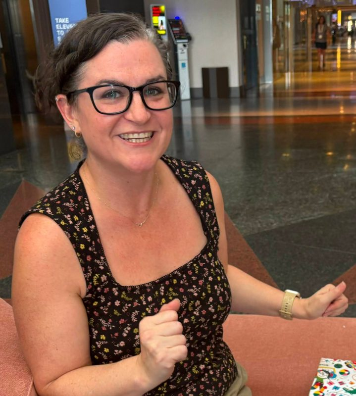
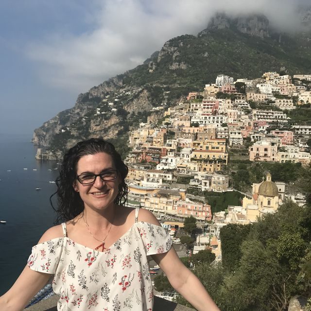
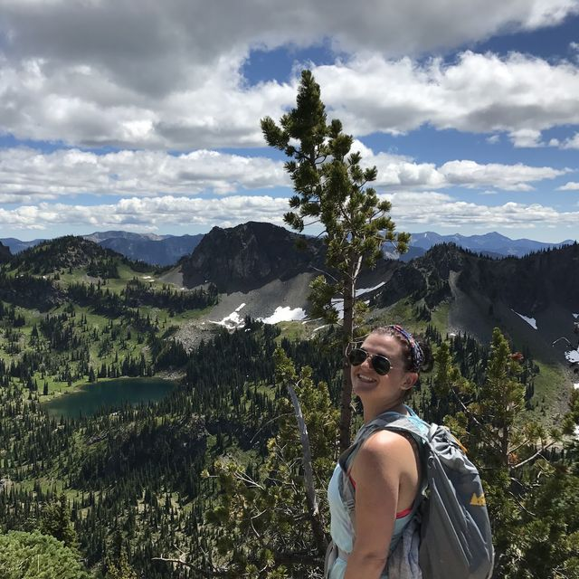
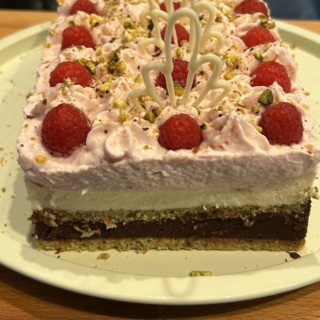
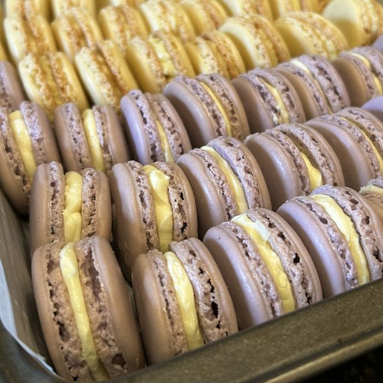
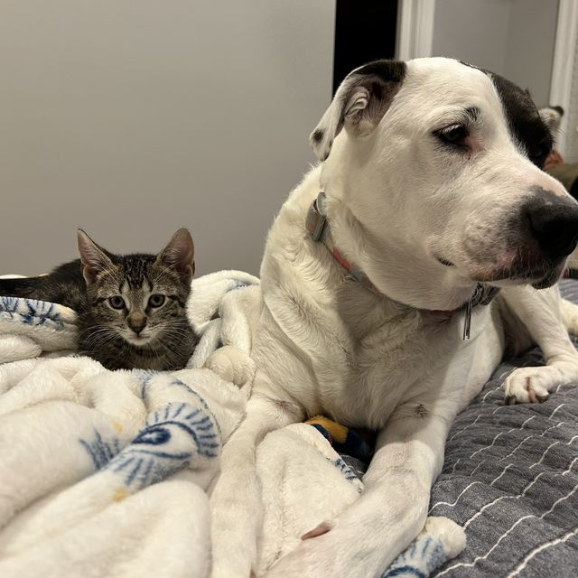
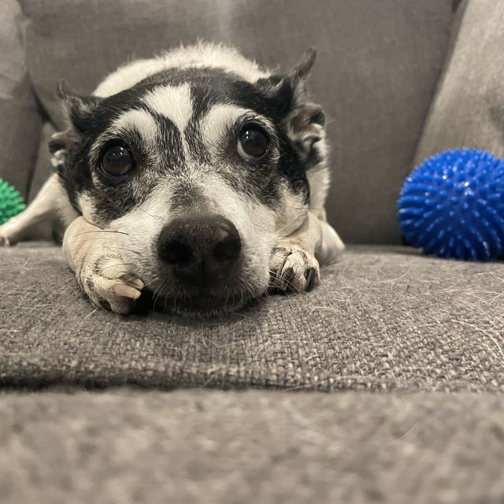

# About Kristal DeCoux | Web Strategy and CRO Leader

> Kristal DeCoux is a web strategy and conversion leader in Lafayette, Louisiana, with 15 years at Ancestry, AWS and Elastic. How she leads and what she loves.

Source: https://kristaldecoux.vercel.app/about/

# Hi, I’m Kristal.

I’m a web strategy and conversion leader with more than 15 years at Ancestry, AWS and Elastic. I’m happiest when I’m figuring out why visitors do what they do, and helping teams build something better because of it. I work remotely from Lafayette, Louisiana.

## How I lead

I lead people the way I approach visitors: by understanding them first.

- **Empathy first.** I learn what each person needs before I ask for anything.
- **Psychological safety.** Half-formed ideas and losing tests are welcome, because that’s where the learning is. I protect a sustainable pace so people can do their best work for the long run.
- **Coaching to your goals.** Growth plans are built around each person’s career goals and passions, not just the team’s needs.
- **Authenticity.** I say what I think, admit what I don’t know and give credit to the people who did the work.

My CliftonStrengths top five are Analytical, Achiever, Belief, Responsibility and Learner. In practice that means I want to see the data, I finish what I start, I do my best work when I believe in the mission, I own my commitments, and I’m always learning something new.

## How I got here

I didn’t start in web strategy. I was managing a call center team at Ancestry when I moved into project management for the analytics team. Their backlog was bigger than they could handle, so I asked for coaching in web analytics and SQL and started taking requests myself. That led to a marketing analyst role, then to test design and statistical analysis when the testing team needed an analyst, and eventually to a test strategist role on that team.

At AWS, I learned user research to redesign the product detail page templates, learned the CMS to build them, and trained product marketers to build their own pages. When that wasn’t enough, I made the case for hiring web producers. Then I built AWS’s testing program, came to Elastic to build another one, and took on the whole web team when the chance came.

Each step started the same way: I saw a problem no one owned, learned what I needed to solve it, then built the process and taught the people so it kept working without me.

## Where I’ve worked

1.  2021 – now
    **Elastic**
    Director, Web Strategy and Development. I own elastic.co: web development, UX design and research, experimentation, SEO and AI search, localization and web merchandising. Earlier roles: Director, Website Strategy and Director, Optimization and Conversion.
2.  2016 – 2021
    **Amazon Web Services**
    Head of Website Analytics and Testing. I founded the AWS website testing program and, before that, led the product detail page redesign as a product manager and digital marketing manager.
3.  2008 – 2016
    **Ancestry**
    Marketing Manager, Conversion Optimization. I started as a call center manager, moved into analytics project management in 2011, then designed and analyzed tests as a conversion analyst and later as a test strategist.

[Download my resume](/resume.pdf)

## Beyond work

I bake the way I test: a new flavor idea, a test batch, a tweak and another try. Most of my experiments start with something I saw on *The Great British Bake Off*.

I read a lot of science fiction, fantasy and magical realism, with a soft spot for absurd humor and the occasional post-apocalyptic world. A few favorites: *Piranesi*, *Spinning Silver*, *The Shadow of the Wind*, *Shantaram* and *Dungeon Crawler Carl*. My friends and I keep a group text just for book recommendations.

I’ve played Dungeons & Dragons online with the same group since 2018. I love puns and dry humor, and I identify with Leslie Knope more than I probably should.

I love teaching, whether it’s A/B testing for a new analyst, cake decorating for my nieces and nephews, or finding a friend the right next book.

I love to hike. My favorite summit so far is Mount Timpanogos in Utah. I’ve hiked all over the Pacific Northwest, especially in the Cascades (including Mount Rainier) and the Olympic Mountains, and down the West Coast: the Oregon coast and dunes, the redwoods, Big Sur, Mount Diablo and the Santa Monica Mountains. Farther east, I’ve hiked Arches, Zion, the Great Smoky Mountains and Ohiopyle State Park in Pennsylvania.

I love history, art and natural history museums, and I’m the kind of nerd who reads almost every plaque. I just love learning something new. Favorites include the Musée d’Orsay, the British Museum and the Art Institute of Chicago, and I know an unusual amount about Van Gogh. I collect work by local artists from Lafayette art walks and festivals, plus small pieces from my travels.

I’ve called six places home: Los Angeles; San Francisco; Seattle; Provo, Utah; Shelton, Connecticut; and now Lafayette, Louisiana. Travel has taken me to England, Scotland, Ireland, Italy, Paris, Madrid and Thailand, and around the US to New York, Chicago, Denver, Austin, Houston and Pennsylvania, among others. My favorite trips have been Ireland, Scotland, Florence and northern Thailand, and Seattle is my favorite place I’ve lived.

I care about animal rescue and welfare. My dog and cat are both rescues, and so were the two dogs before them. I also care about access to education and culture for rural and underserved communities. I’m drawn to organizations with a mission.

Positano, Italy

On the trail

My take on a raspberry pistachio bake from *Bake Off*

Macarons

My rescues today

My rescue rat terrier

## I’d love to hear what you’re working on.

`kmdecoux@gmail.com`

[linkedin.com/in/kristal-decoux](https://www.linkedin.com/in/kristal-decoux)

---

More: [Site map](https://kristaldecoux.vercel.app/sitemap.xml) · [llms.txt](https://kristaldecoux.vercel.app/llms.txt)
