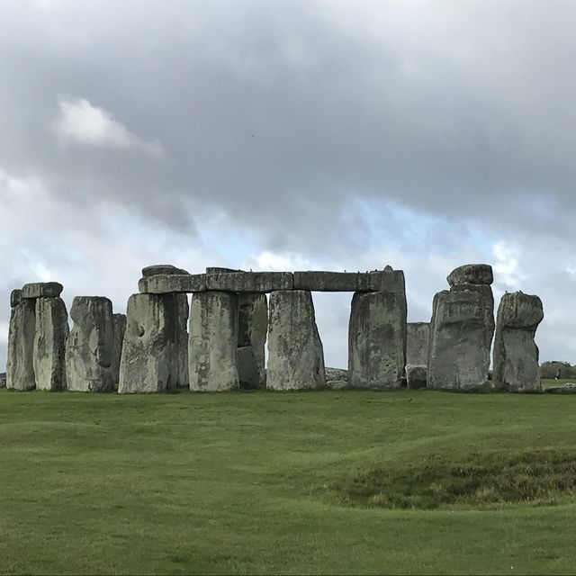

# About Kristal DeCoux | Web Strategy and CRO Leader

> Kristal DeCoux is a web strategy and conversion leader in Lafayette, Louisiana, with 15 years at Ancestry, AWS and Elastic. How she leads and what she loves.

Source: https://kristaldecoux.vercel.app/about/

# Hi, I’m Kristal.

I’m a web strategy and conversion leader with more than 15 years at Ancestry, AWS and Elastic. I’m happiest when I’m figuring out why visitors do what they do, and helping teams build something better because of it. I work remotely from Lafayette, Louisiana.

## How I lead

I lead people the way I approach visitors: by understanding them first.

- **Empathy first.** I learn what each person needs before I ask for anything.
- **Psychological safety.** Half-formed ideas and losing tests are welcome, because that’s where the learning is. I protect a sustainable pace so people can do their best work for the long run.
- **Coaching to your goals.** Growth plans are built around each person’s career goals and passions, not just the team’s needs.
- **Authenticity.** I say what I think, admit what I don’t know and give credit to the people who did the work.

## Where I’ve worked

1.  2021 – now
    **Elastic**
    Director, Web Strategy and Development. I own elastic.co: web development, UX design and research, experimentation, SEO and AI search, localization and web merchandising. Earlier roles: Director, Website Strategy and Director, Optimization and Conversion.
2.  2016 – 2021
    **Amazon Web Services**
    Head of Website Analytics and Testing. I founded the AWS website testing program and, before that, led the product detail page redesign as a product manager and digital marketing manager.
3.  2011 – 2016
    **Ancestry**
    Marketing Manager, Conversion Optimization. I started in analytics project management, then designed and analyzed tests as a conversion analyst.

[Download my resume](/resume.pdf)

## Beyond work

I bake the way I test: a new flavor idea, a test batch, a tweak and another try. Most of my experiments start with something I saw on *The Great British Bake Off*.

I read a lot of science fiction, fantasy and magical realism, with a soft spot for absurd humor and the occasional post-apocalyptic world.

I love to hike. My favorite summit so far is Mount Timpanogos in Utah, and I’ve hiked in Arches, Zion, Mount Rainier and the Great Smoky Mountains.

I’ve called six places home: Los Angeles; San Francisco; Seattle; Provo, Utah; Shelton, Connecticut; and now Lafayette, Louisiana. Travel has taken me to England, Scotland, Ireland, Italy, Paris, Madrid and Thailand, and around the US to New York, Chicago, Denver, Austin, Houston and Pennsylvania, among others.

I care about animal rescue and welfare, and about access to education and culture for rural and underserved communities. I’m drawn to organizations with a mission.

Positano, Italy

On the trail

From my kitchen

Macarons

Quality control

Stonehenge, England

## I’d love to hear what you’re working on.

`kmdecoux@gmail.com`

[linkedin.com/in/kristal-decoux](https://www.linkedin.com/in/kristal-decoux)

---

More: [Site map](https://kristaldecoux.vercel.app/sitemap.xml) · [llms.txt](https://kristaldecoux.vercel.app/llms.txt)
