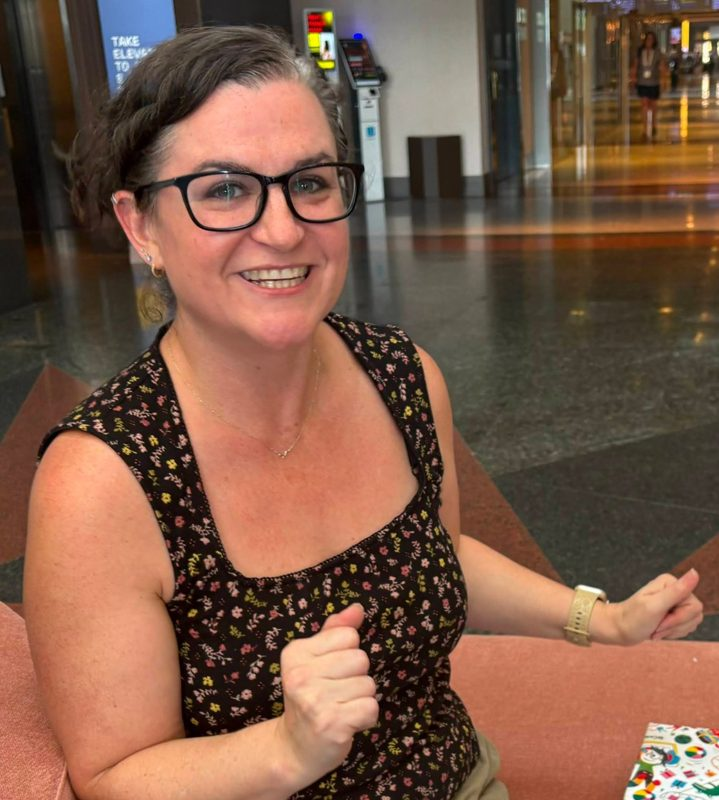

# Kristal DeCoux | Web Strategy & Conversion Rate Optimization

> Web strategy and conversion leader with 15 years at Ancestry, AWS and Elastic. See case studies in CRO, A/B testing, UX research, SEO and AI search visibility.

Source: https://kristaldecoux.vercel.app/

Kristal DeCoux · Web strategy and conversion leader

# I turn customer curiosity into journeys that convert.

Across sites, landing pages, signups and forms, I use analytics, research and experimentation to find where people get stuck. I’ve done it for 15 years at Ancestry, AWS and Elastic, and built the teams and programs that keep the work going.

[See my work](/work/) [Download resume](/resume.pdf)

## Results

**AncestryAWSElastic**

**\$4.8M**annualized revenue from Ancestry tests I owned

**46%**win rate on the first 50 tests of the AWS website program

**+73%**Elastic Cloud trial signups from one homepage test

**3×**visibility of solutions content after the Elastic homepage redesign

## Selected work

Redesigns, templates and programs that changed how people move from a first visit to a trial, a lead or a purchase.

Elastic · Homepage and key pages

### From a stalled redesign to a leadership yes

After a costly agency redesign and a shelved first attempt, we won alignment one section at a time and shipped five key pages a day early.

Homepage scroll-through rose from under 9% to about 25%.

[Read the case study](/work/#elastic-redesign)

![](data:image/svg+xml;base64,PHN2ZyB2aWV3Ym94PSIwIDAgMzIwIDMwMCIgcm9sZT0iaW1nIiBhcmlhLWxhYmVsPSJTb2x1dGlvbnMgcGFnZSBzdHJ1Y3R1cmU6IGhlcm8gbGVhZGluZyB3aXRoIHRoZSBwcm9kdWN0IGNhdGVnb3J5LCB0aGVuIHByb2JsZW0sIHBsYXRmb3JtLCBwcm9vZiBhbmQgYSBjYWxsIHRvIGFjdGlvbiIgZm9jdXNhYmxlPSJmYWxzZSI+PHJlY3QgY2xhc3M9IndmLWZyYW1lIiB4PSIxIiB5PSIxIiB3aWR0aD0iMzE4IiBoZWlnaHQ9IjI5OCIgcng9IjYiPjwvcmVjdD48cmVjdCBjbGFzcz0id2YtYmFyIiB4PSIxIiB5PSIxIiB3aWR0aD0iMzE4IiBoZWlnaHQ9IjE2IiByeD0iNiI+PC9yZWN0PjxyZWN0IGNsYXNzPSJ3Zi1iYXIiIHg9IjEiIHk9IjkiIHdpZHRoPSIzMTgiIGhlaWdodD0iOCI+PC9yZWN0PjxjaXJjbGUgY2xhc3M9IndmLWRvdCIgY3g9IjEyIiBjeT0iOSIgcj0iMi41Ij48L2NpcmNsZT48Y2lyY2xlIGNsYXNzPSJ3Zi1kb3QiIGN4PSIyMSIgY3k9IjkiIHI9IjIuNSI+PC9jaXJjbGU+PGNpcmNsZSBjbGFzcz0id2YtZG90IiBjeD0iMzAiIGN5PSI5IiByPSIyLjUiPjwvY2lyY2xlPjxyZWN0IGNsYXNzPSJ3Zi1ob3QiIHg9IjE2IiB5PSIyOCIgd2lkdGg9IjI4OCIgaGVpZ2h0PSI1NCIgcng9IjMiPjwvcmVjdD48dGV4dCBjbGFzcz0id2YtaG90LXRleHQiIHg9IjI0IiB5PSI1OS4wIj5IZXJvOiBsZWFkcyB3aXRoIHRoZSBwcm9kdWN0IGNhdGVnb3J5PC90ZXh0PjxyZWN0IGNsYXNzPSJ3Zi1ob3QiIHg9IjE2IiB5PSI5MCIgd2lkdGg9IjI4OCIgaGVpZ2h0PSI0MCIgcng9IjMiPjwvcmVjdD48dGV4dCBjbGFzcz0id2YtaG90LXRleHQiIHg9IjI0IiB5PSIxMTQuMCI+UHJvYmxlbTwvdGV4dD48cmVjdCBjbGFzcz0id2YtaG90IiB4PSIxNiIgeT0iMTM4IiB3aWR0aD0iMjg4IiBoZWlnaHQ9IjUwIiByeD0iMyI+PC9yZWN0Pjx0ZXh0IGNsYXNzPSJ3Zi1ob3QtdGV4dCIgeD0iMjQiIHk9IjE2Ny4wIj5QbGF0Zm9ybTwvdGV4dD48cmVjdCBjbGFzcz0id2YtaG90IiB4PSIxNiIgeT0iMTk2IiB3aWR0aD0iMjg4IiBoZWlnaHQ9IjQwIiByeD0iMyI+PC9yZWN0Pjx0ZXh0IGNsYXNzPSJ3Zi1ob3QtdGV4dCIgeD0iMjQiIHk9IjIyMC4wIj5Qcm9vZjogY3VzdG9tZXIgc3RvcmllczwvdGV4dD48cmVjdCBjbGFzcz0id2YtaG90IiB4PSIxNiIgeT0iMjQ0IiB3aWR0aD0iMjg4IiBoZWlnaHQ9IjM0IiByeD0iMyI+PC9yZWN0Pjx0ZXh0IGNsYXNzPSJ3Zi1ob3QtdGV4dCIgeD0iMjQiIHk9IjI2NS4wIj5DYWxsIHRvIGFjdGlvbjwvdGV4dD48L3N2Zz4=)

The shared structure every solutions page now follows. Illustration, not a screenshot.

AWS · Product detail pages

### Product pages still in use ten years later

Analytics, a card sort, usability sessions and focus groups in three cities shaped a five-page template set for every product.

800+ pages migrated, and the structure still runs aws.amazon.com.

[Read the case study](/work/#aws-pdp)

Experimentation · Ancestry, AWS, Elastic

### Tests that won, and tests that taught me more

Control-versus-variant results with the hypothesis, the data behind it and what each test taught me.

Including the homepage test that lifted trial signups 73%.

[See the experiments](/experiments/)

## How I work

The same loop runs through every program I’ve built, whether the change is a headline, a form field or a full redesign.

1.  ### Listen to the data

    Analytics, heatmaps, session recordings, surveys and usability studies, side by side.

2.  ### Write the hypothesis

    If we change this, we expect that, because of what we saw. Evidence, not preference.

3.  ### Test and measure

    Sized up front and judged on trials, leads and revenue rather than clicks.

4.  ### Share and scale

    Readouts, workshops and templates so every team gets better at this work.

[More on my method and the programs I’ve built](/how-i-work/)

## AI tools I’ve built

Claude skills that take repetitive work off my team’s plate and put expert checks in everyone’s hands.

- ### SEO review

  Content authors run it on draft copy in their own Claude. It returns keyword and copy recommendations, page schema, and title and description metadata.

  Our content now shows up more often in AI answers and overviews.

- ### Optimization brief

  Paste a test or merchandising request from an email, Slack thread or ticket. It returns an experiment brief, a test plan, a tracking issue and a review email, with targeting and metric names that follow our conventions.

  One request in, every launch document out.

- ### Request triage

  Reads incoming web requests, flags missing or incomplete information and replies to the requester.

  Triage went from about an hour to seconds.

[How each tool works](/ai/) · [How I built this website with AI](/ai/#this-site)

## How I lead

I lead people the way I approach visitors: start by understanding them.

- ### Empathy first

  I learn what each person needs before I ask for anything.

- ### Psychological safety

  Half-formed ideas and losing tests are welcome. That’s where the learning is.

- ### Coaching to your goals

  Growth plans built around each person’s career goals and passions.

- ### Authenticity

  I say what I think, admit what I don’t know and credit the people who did the work.

### Beyond work

I bake the way I test: a new flavor idea, a test batch, a tweak and another try. Most start with something I saw on *The Great British Bake Off*.

I read science fiction, fantasy and magical realism, and I care about animal rescue and access to education and culture in rural and underserved communities.

[More about me](/about/)

## Let’s talk about what your visitors are trying to tell you.

`kmdecoux@gmail.com`

[linkedin.com/in/kristal-decoux-6514219](https://www.linkedin.com/in/kristal-decoux-6514219/)

---

More: [Site map](https://kristaldecoux.vercel.app/sitemap.xml) · [llms.txt](https://kristaldecoux.vercel.app/llms.txt)
